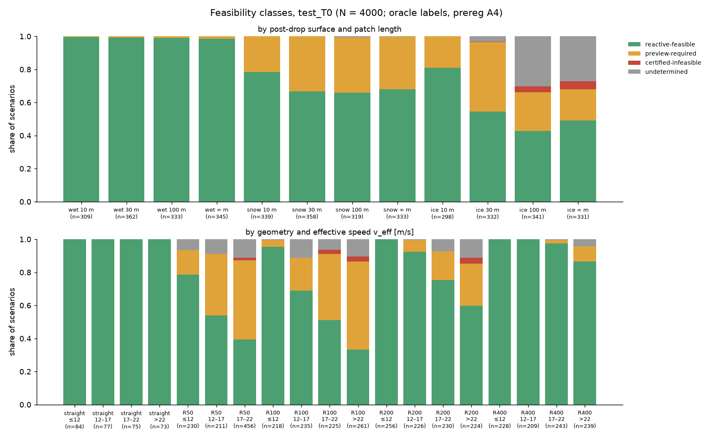
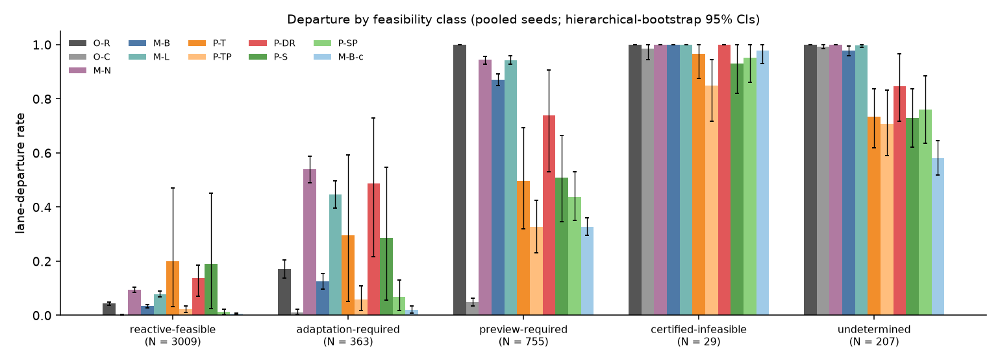
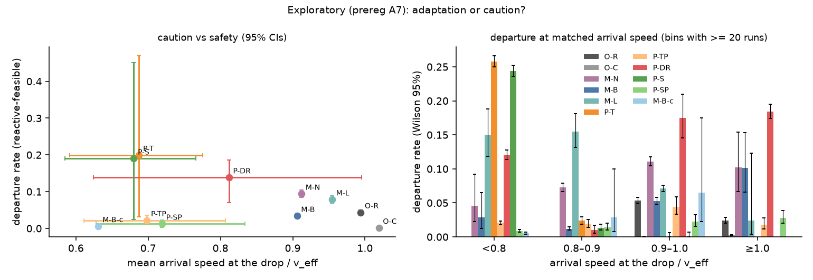
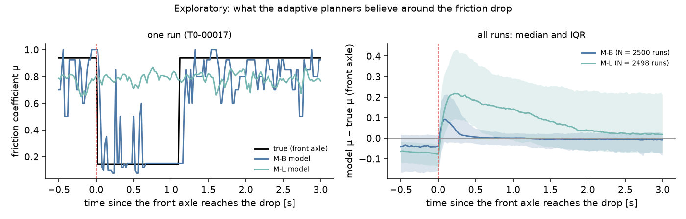
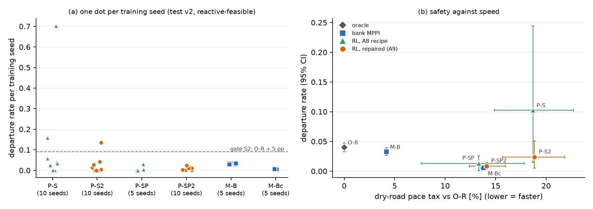

# Friction-Cliff-Bench

When the road suddenly turns to ice, can a learned policy that adapts from its own history keep a car in its lane
better than an adaptive model-predictive controller, with the same information and the same tuning budget? And in
which scenarios can nothing save the car?


*Tuning scenario, not a result. Orange lines are the planner's sampled plans, simulated with the planner's own
friction model: the friction-blind planner keeps believing it can turn.*

This is a simulation benchmark for car control under abrupt tire–road friction loss (dry to wet, snow or ice). It
compares an RMA-style PPO policy with adaptive MPPI and with known-friction oracles. Every scenario is first labelled
by what is physically possible, and the hypotheses, metrics and statistics were pre-registered before any test
scenario was labelled. The confirmatory runs use my own C++17/CUDA MPPI. The full write-up is the
[technical report](paper/main.tex) (`cd paper && tectonic main.tex`).

## Findings
- **Under parity, the learned policy did not beat the model-bank MPPI.** The point estimate favours the MPPI, and the
  interval is wide because the PPO training seeds ranged from excellent to failing.
- **Much of the apparent robustness is slowing down.** The trained policies reach the friction drop well below the
  reference speed. The bank MPPI driven at the same speed is at least as safe, and the dry-road pace tax prices that
  caution.
- **The seed instability had a specific cause.** Training kept checkpoints by success under exploration noise, but
  the policy is deployed without noise. Selecting checkpoints on noiseless held-out validation fixed it. In a second
  pre-registered test on fresh scenarios (amendment A9), every seed of the repaired policy passed the reliability
  gate, and at matched speed it was non-inferior to the bank MPPI, though not better.
- **Model mismatch did not hurt the bank MPPI** on any of the three tested axes, contrary to my prediction (H2).
- **Labels change the ranking.** Where only a preview of the road ahead can save the car, reactive controllers
  nearly always fail. A pooled failure rate over all scenarios mostly measures the scenario mix.

All numbers, with N and 95% intervals, are in [Results](#results). They are written by the evaluation harness,
not by hand.

## How it works
1. **Feasibility labels.** A friction-circle certificate proves when no controller can stay in the lane. Oracle MPPI
   controllers that know the true friction show when recovery is possible and whether it needs a preview of the road
   ahead. Classes: reactive-feasible, preview-required, certified-infeasible, undetermined. Controllers are ranked
   only where the car can be saved.
2. **Matched contenders.** Adaptive MPPI with a model bank (LLA-MPC style) or a learned friction estimator; an
   RMA-style teacher–student PPO policy (the teacher sees friction, the student infers it from history); a
   domain-randomised PPO policy; and a student of a teacher that previews the road ahead. All share one objective,
   one observation history and an equal, logged tuning budget.
3. **Oracles** give the regret reference on every scenario.
4. **Pre-registration.** Hypotheses H1–H3 with falsifiers, the scenario sampler and seeds, the tuning budget, the
   oracle settings and the statistics (hierarchical bootstrap, TOST at ±5 pp, Holm) are in
   [`docs/PREREGISTRATION.md`](docs/PREREGISTRATION.md). Later changes are dated amendments (A1–A9) with reasons in
   [`docs/DECISIONS.md`](docs/DECISIONS.md).

Verification habits: simulator physics written test-first and cross-checked against an independent float64 model;
the C++ MPPI reproduces Warp's random number generator bit for bit, so both implementations draw the same samples
and are compared on whole control steps; frozen values (parameters, splits, oracle settings) are fingerprinted in
CI; tuning trials and GPU-hours are logged per method.

## Repository layout
```
sim/          GPU vehicle simulator in NVIDIA Warp: dynamic bicycle, combined-slip Pacejka tires, wheel spin,
              relaxation, actuator lag/delay, per-axle friction fields; float64 NumPy reference model
scenarios/    tracks (straight, clothoid curves R 50-400 m), scenario sampler, frozen hashed splits
feasibility/  analytic friction-circle certificate (soundness argument in docs/FEASIBILITY.md)
labelling/    oracle labelling and sanity gate S1
control/      batched Warp MPPI, oracles, model-bank and learned-estimator MPPI, C++ backend binding
rl/           GPU RL environment, PPO teacher, RMA student, DR policy, training library
mppi_cpp/     C++17/CUDA MPPI: __host__ __device__ dynamics and MPPI kernels, CPU + CUDA drivers, GoogleTest
eval/         episode runner, tuning harness with budget ledger, evaluation runner, statistics, analysis
scripts/      setup/ (splits, labels, libraries), train/, evaluate/, report/ (figures, tables, finalize.sh), bench/
tests/        pytest suite: simulator vs reference, certificate soundness, MPPI, RL env, statistics, C++ equivalence
splits/ labels/ ledgers/   frozen scenario sets, oracle labels, tuning ledger and hash ledgers
paper/        technical report (LaTeX); paper/gen/ is written by the harness
```

## Run it
```bash
uv sync                                   # Python 3.12, PyTorch (CUDA 12.8+), warp-lang
uv run pytest -q                          # fast suite (GPU tests need a CUDA device); slow: -m slow
cmake -S mppi_cpp -B mppi_cpp/build -DCMAKE_CUDA_COMPILER=/usr/local/cuda/bin/nvcc
cmake --build mppi_cpp/build -j && ./mppi_cpp/build/fcb_tests      # GoogleTest
MPPI_BACKEND=cpp PYTHONPATH=. uv run pytest -q tests/test_mppi_cpp.py   # C++ vs Warp equivalence
bash scripts/report/finalize.sh           # regenerate every table, figure and report fragment from the run logs
```
The evaluation itself (`scripts/evaluate/eval_split.py`, `scripts/evaluate/eval_v2.py`) takes more than a day on one
laptop GPU; run logs go to `runs/` (not in the repository).

## Grounding against real cars
The simulated car's steady-state understeer is compared with ten passenger-car platforms from openpilot driving logs
([commaSteeringControl](https://huggingface.co/datasets/commaai/commaSteeringControl), MIT). The steering ratio is
fitted, not assumed: [`docs/results/grounding/`](docs/results/grounding/comma_understeer.md). The scenario friction
levels are compared with road-weather sensor logs from winter drives at Mcity (MARWIS, part of
[MCity-WSPI](https://huggingface.co/datasets/AD-Assurance-Lab/winter-driving-dataset), CC-BY-4.0):
[`docs/results/grounding/marwis.md`](docs/results/grounding/marwis.md).

## Results
<!-- RESULTS:BEGIN -->
Confirmatory test split: 4,000 scenarios, 3,009 of them reactive-feasible, 5 seeds per method. Intervals are 95% hierarchical-bootstrap CIs over scenarios and seeds. Full tables: [`docs/results/results.md`](docs/results/results.md).

> **Caveat (gate S2 failed, amendment A8).** The final PPO teacher departed on 0.197 of N = 1,535 reactive-feasible *tuning* runs (Wilson 95% [0.178, 0.218]) vs 0.037 for the oracle. The cause is seed-to-seed instability, so per-seed results are reported and no seed was dropped.

| method | | departure on reactive-feasible scenarios [95% CI] |
|---|---|---|
| O-R | oracle, knows current friction | 0.044 [0.037, 0.050] |
| O-C | oracle, sees the road ahead | 0.001 [0.000, 0.003] |
| M-N | MPPI, assumes dry road | 0.094 [0.084, 0.104] |
| M-B | adaptive MPPI, model bank | 0.034 [0.028, 0.040] |
| M-L | adaptive MPPI, learned estimator | 0.078 [0.069, 0.089] |
| M-B-c | M-B at the student's arrival speed (exploratory, A7) | 0.006 [0.003, 0.008] |
| P-T | PPO teacher (sees friction) | 0.199 [0.031, 0.470] |
| P-TP | PPO teacher with road preview | 0.022 [0.010, 0.035] |
| P-DR | domain-randomized PPO | 0.139 [0.070, 0.186] |
| P-S | RMA student (history only) | 0.190 [0.024, 0.451] |
| P-SP | student of the preview teacher | 0.012 [0.003, 0.023] |

- **H1** (prediction: the RMA student does *not* depart less than the better adaptive MPPI by more than 5 pp): departure(M-B) − departure(P-S) = -15.6 pp [-42.1, +1.0]; not falsified. TOST ±5 pp: equivalence not shown.
  The interval is wide because the student's five training seeds depart between 0.003 and 0.710; the worst seed departs on 0.656 of dry-road runs without any friction drop, so its failures are mostly lane keeping, not adaptation. Per-seed tables: `docs/results/results.md`.
- **H2** (prediction: under model mismatch the adaptive MPPI's regret grows faster than the student's, and the curves cross): 0 of 3 axes pass; not supported.
- **H3** (prediction: the student of the current-friction teacher matches or beats the preview-teacher student): departure(P-S) − departure(P-SP) = +17.7 pp [+1.2, +44.3], P-SP's dry-progress loss vs P-S = -5.5% [-17.6, 4.1]; not falsified (the falsifier needs lower departure *and* an upper CI bound of the dry-progress loss below 2%).
- Holm–Bonferroni over the three pre-registered tests (α = 0.05): none significant. p = H1 1.000, H3 0.075, H2 1.000.
- **Adaptation or caution?** (exploratory, rule fixed in A7 before the test run) The bank MPPI driven at the student's arrival speed departs 0.006 vs P-S 0.190; difference -18.4 pp [-45.2, -1.9], so no student advantage to explain. Slowing down has a price: M-B-c loses 16.0% [15.4, 16.7] of dry-road progress against O-R, M-B 4.2% [4.0, 4.5].
- **Compute** (NVIDIA GeForce RTX 5090 Laptop GPU, median of N = 30): one MPPI control step (K = 1,024 samples, H = 150) takes 15.3 ms in C++/CUDA vs 15.8 ms in Warp. For 64 cars at once: 46.8 vs 58.9 ms. Details: [`docs/results/compute_benchmarks.md`](docs/results/compute_benchmarks.md).
- **Learned-policy latency:** one forward pass of the student takes 0.19 ms for one car on one CPU thread (median of N = 300, feature computation excluded; [`docs/results/compute_policy.md`](docs/results/compute_policy.md)).

**Follow-up (pre-registered amendment A9, fresh test pool v2, N = 2,233 reactive-feasible scenarios).** The learned policy's training was repaired (checkpoints selected on deterministic held-out validation; diagnosis in the technical report, Section 10) and re-tested. Full tables: [`docs/results/followup.md`](docs/results/followup.md).

| method | seeds | departure [95% CI] | per-seed range | dry pace tax [95% CI] |
|---|---|---|---|---|
| O-R | 5 | 0.0400 [0.0325, 0.0474] | 0.038–0.044 | 0.0% [-0.0, 0.0] |
| M-B | 5 | 0.0325 [0.0263, 0.0393] | 0.030–0.036 | 4.2% [4.1, 4.3] |
| M-Bc | 5 | 0.0055 [0.0029, 0.0084] | 0.004–0.008 | 13.8% [13.5, 14.1] |
| P-S | 10 | 0.1026 [0.0146, 0.2448] | 0.000–0.704 | 18.7% [14.9, 22.7] |
| P-SP | 5 | 0.0131 [0.0013, 0.0261] | 0.000–0.030 | 13.3% [7.6, 17.8] |
| P-S2 | 10 | 0.0236 [0.0050, 0.0508] | 0.000–0.135 | 18.8% [15.7, 21.8] |
| P-SP2 | 10 | 0.0085 [0.0037, 0.0142] | 0.001–0.023 | 14.1% [12.4, 16.0] |

- **H4** (P-SP2 against M-Bc, the bank MPPI slowed to P-SP2's pace): at matched pace its lane-departure rate is non-inferior to the bank MPPI's (difference +0.3 pp [-0.3, +0.9], margin 2 pp).
- **H5** (P-SP2): all 10 training seeds pass the per-seed reliability gate (P-S 8/10; P-SP 5/5; P-S2 9/10; P-SP2 10/10).
<!-- RESULTS:END -->

## Figures
All figures are generated from the run logs by `scripts/report/finalize.sh`.

**What is physically possible.** Feasibility class of every test scenario, by post-drop surface and patch length
(top) and by curve radius and speed (bottom). Ice, long patches, tight curves and high speed make preview necessary
or the car unsaveable.



**Who leaves the lane, per class.** Departure rate of every method in each feasibility class, with 95% CIs. Only the
reactive-feasible group (left) is used to rank controllers; the others show what the labels predict.



**Adaptation or caution?** Left: departure against mean arrival speed at the friction drop. The learned policies
arrive slower; the bank MPPI slowed to the student's speed (M-B-c) is the safest non-oracle method. Right: departure
within arrival-speed bins.



**What the adaptive planners believe.** The model-bank MPPI's friction estimate catches the drop within a fraction
of a second; the learned estimator stays too optimistic for more than a second.



**Follow-up (A9).** Left: departure of every training seed on the fresh test pool; the repaired policies (orange)
all sit below the reliability gate. Right: departure against dry-road pace; at matched pace the repaired student
and the slowed bank MPPI overlap.



More: [H1 interval](docs/results/fig_h1.png), [model mismatch (H2)](docs/results/fig_h2.png),
[per-cell regime map](docs/results/fig_regime_map.png), [exploratory E1–E3](docs/results/fig_exploratory.png),
[analytic feasibility map](docs/figures/feasibility_map.png),
[understeer vs real cars](docs/results/grounding/comma_understeer.png),
[friction levels vs road sensors](docs/results/grounding/marwis.png).

## Limitations
Simulation only, with a planar single-track model; one vehicle; friction changes along the lane only. Tuning,
training and evaluation run on one laptop GPU, which bounds the scenario counts and the number of training seeds.
The technical report lists the rest.

## Documents
| File | Contents |
|---|---|
| [`docs/DESIGN.md`](docs/DESIGN.md) | Vehicle model, tracks, scenario space, shared objective, simulator validation |
| [`docs/PARAMETERS.md`](docs/PARAMETERS.md) | Source and plausible range of every vehicle and tire value |
| [`docs/FEASIBILITY.md`](docs/FEASIBILITY.md) | Labels, the certificate and its soundness argument, oracles, gate S1 |
| [`docs/BASELINES.md`](docs/BASELINES.md) | Controller set, fairness checklist, MPPI, RL and C++ specs |
| [`docs/EVAL_PROTOCOL.md`](docs/EVAL_PROTOCOL.md) | Metrics, splits, seeds, statistics, reporting rules |
| [`docs/PREREGISTRATION.md`](docs/PREREGISTRATION.md) | Research questions, hypotheses, gates, amendments A1–A9 |
| [`docs/RELATED_WORK.md`](docs/RELATED_WORK.md) | Closest work and how this differs |
| [`docs/DECISIONS.md`](docs/DECISIONS.md) | Dated design decisions and their reasons |
| [`docs/LOG.md`](docs/LOG.md) | Dated lab notebook: run verdicts, tuning ledger, incidents |
| [`docs/results/`](docs/results/) | Harness output: results, follow-up, exploratory, compute, grounding |
