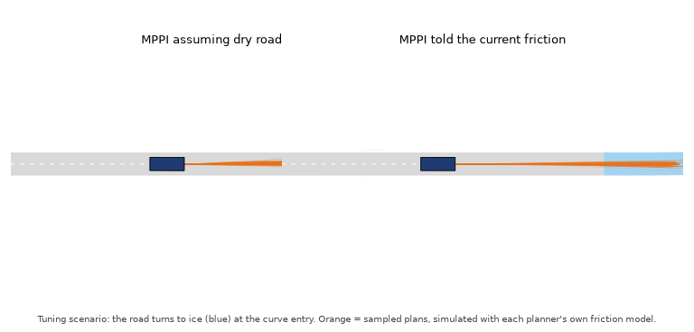

# Friction-Cliff-Bench

**When the road suddenly turns to ice, can a learned policy that adapts from its own history keep a car on the
road better than an adaptive model-predictive controller, under equal information and an equal tuning budget?**
And in which scenarios can *nothing* save the car?



*Tuning scenario, not a result. Orange lines are the planner's sampled plans, simulated with the planner's own
friction model: the friction-blind planner keeps believing it can turn.*

**Status (Nov 2026):** complete. The 4,000-scenario test split was labelled and frozen
([class breakdown](docs/figures/labels_test_T0.md)), every method was tuned under the logged budget and trained with
5 seeds, and the confirmatory evaluation is done: see [Results](#results) and the
[technical report](paper/main.tex) (`cd paper && tectonic main.tex`). **In short:** under matched information and
budget, the RMA student did not beat the bank-adaptive MPPI. Its five training seeds ranged from excellent to failing,
and much of the apparent robustness to a friction drop comes from slowing down early. A pre-registered follow-up
(amendment A9) traced the seed instability to checkpoint selection (training kept checkpoints by noisy training
success, but the policy is deployed without noise), fixed it, and re-tested on fresh scenarios: the repaired
preview-teacher student passed the reliability gate on every training seed and was non-inferior to the bank MPPI at
matched pace, though not better ([follow-up results](#results)). The protocol was
[pre-registered](docs/PREREGISTRATION.md) (`prereg-v1`) before any test scenario was labelled or evaluated; later
changes are dated amendments.

## What it is
A benchmark of vehicle control under **abrupt tire–road friction loss** (dry → wet / snow / ice), built so that the
comparison cannot quietly favour one side:

1. **Every scenario is labelled by what is physically possible.** A friction-circle certificate proves when no
   controller can stay in lane; oracle controllers that know the true friction show when recovery *is* possible,
   and whether it needs a preview of the road ahead. Classes: reactive-feasible, preview-required,
   certified-infeasible, undetermined. Controllers are only ranked where saving the car is possible.
2. **The contenders, with matched information and an equal, logged tuning budget:**
   - adaptive MPPI with a **model bank** (LLA-MPC style) or a **learned friction estimator**;
   - an **RMA-style teacher → student PPO** policy (the teacher sees friction; the student infers it from history);
   - a domain-randomized PPO policy, and a student of a teacher that previews the road ahead (H3).
3. **Known-friction oracles** (reactive and clairvoyant MPPI) give the regret reference on every scenario.
4. **Confirmatory runs use our own C++17/CUDA MPPI**, checked against the reference implementation.

The intended output is a regime map: *where each method wins, where nobody can win, and why*. Not "RL beats MPC".

## How it is built
```
sim/          GPU vehicle simulator in NVIDIA Warp: dynamic bicycle, combined-slip Pacejka tires, wheel spin,
              relaxation, actuator lag/delay, per-axle friction fields; float64 NumPy reference model
scenarios/    tracks (straight, clothoid curves R 50-400 m), scenario sampler, frozen hashed splits
feasibility/  analytic friction-circle certificate (soundness argument in docs/FEASIBILITY.md)
labelling/    oracle labelling + sanity gate S1
control/      batched Warp MPPI, oracles, model-bank and learned-estimator MPPI, C++ backend binding
rl/           GPU RL environment, PPO teacher / RMA student / DR policy, training library
mppi_cpp/     C++17/CUDA MPPI: __host__ __device__ dynamics and MPPI kernels, CPU + CUDA drivers, GoogleTest
eval/         episode runner, tuning harness with budget ledger, evaluation runner, statistics, analysis
scripts/      labelling, tuning, training, gates, benchmarks, figures
tests/        pytest suite (simulator vs reference, certificate soundness, MPPI, RL env, statistics, C++ equivalence)
```

**Verification habits:** simulator physics written test-first and cross-checked against an independent float64
model; the C++ MPPI reproduces Warp's random number generator bit for bit, so both implementations draw the same
samples and are compared on whole control steps (gate S3); frozen values (parameters, splits, oracle settings) are
fingerprinted in CI; tuning trials and GPU-hours are logged per method.

## What is pre-registered
Hypotheses H1–H3 with falsifiers, metrics and statistics (hierarchical bootstrap, TOST at a ±5 pp margin, Holm),
the scenario sampler and seeds, the tuning budget, the oracle settings, and the evaluation plan. See
[`docs/PREREGISTRATION.md`](docs/PREREGISTRATION.md); every later change is a dated amendment (A1–A8) with its
reason in [`docs/DECISIONS.md`](docs/DECISIONS.md).

## Run it
```bash
uv sync                                   # Python 3.12, PyTorch (CUDA 12.8+), warp-lang
uv run pytest -q                          # fast suite (GPU tests need a CUDA device); slow: -m slow
cmake -S mppi_cpp -B mppi_cpp/build -DCMAKE_CUDA_COMPILER=/usr/local/cuda/bin/nvcc
cmake --build mppi_cpp/build -j && ./mppi_cpp/build/fcb_tests      # GoogleTest
MPPI_BACKEND=cpp PYTHONPATH=. uv run pytest -q tests/test_mppi_cpp.py   # C++ vs Warp equivalence
```

## Grounding against real cars
The simulated car's steady-state understeer is compared with ten passenger-car platforms from openpilot driving logs
([commaSteeringControl](https://huggingface.co/datasets/commaai/commaSteeringControl), MIT). The steering ratio is
fitted, not assumed. Script, table and figure: [`docs/results/grounding/`](docs/results/grounding/comma_understeer.md).
The scenario friction levels are compared with road-weather sensor logs from winter drives at Mcity (MARWIS, part
of [MCity-WSPI](https://huggingface.co/datasets/AD-Assurance-Lab/winter-driving-dataset), CC-BY-4.0):
[`docs/results/grounding/marwis.md`](docs/results/grounding/marwis.md).

## Results
<!-- RESULTS:BEGIN -->
Confirmatory test split: 4,000 scenarios, 3,009 of them reactive-feasible, 5 seeds per method. Intervals are 95% hierarchical-bootstrap CIs over scenarios and seeds. Full tables: [`docs/results/results.md`](docs/results/results.md).

> **Caveat (gate S2 failed, amendment A8).** The final PPO teacher departed on 0.197 of N = 1,535 reactive-feasible *tuning* runs (Wilson 95% [0.178, 0.218]) vs 0.037 for the oracle. The cause is seed-to-seed instability, so per-seed results are reported and no seed was dropped.

| method | | departure on reactive-feasible scenarios [95% CI] |
|---|---|---|
| O-R | oracle, knows current friction | 0.044 [0.037, 0.050] |
| O-C | oracle, sees the road ahead | 0.001 [0.000, 0.003] |
| M-N | MPPI, assumes dry road | 0.094 [0.084, 0.104] |
| M-B | adaptive MPPI, model bank | 0.034 [0.028, 0.040] |
| M-L | adaptive MPPI, learned estimator | 0.078 [0.069, 0.089] |
| M-B-c | M-B at the student's arrival speed (exploratory, A7) | 0.006 [0.003, 0.008] |
| P-T | PPO teacher (sees friction) | 0.199 [0.031, 0.470] |
| P-TP | PPO teacher with road preview | 0.022 [0.010, 0.035] |
| P-DR | domain-randomized PPO | 0.139 [0.070, 0.186] |
| P-S | RMA student (history only) | 0.190 [0.024, 0.451] |
| P-SP | student of the preview teacher | 0.012 [0.003, 0.023] |

- **H1** (prediction: the RMA student does *not* depart less than the better adaptive MPPI by more than 5 pp): departure(M-B) − departure(P-S) = -15.6 pp [-42.1, +1.0]; not falsified. TOST ±5 pp: equivalence not shown.
  The interval is wide because the student's five training seeds depart between 0.003 and 0.710; the worst seed departs on 0.656 of dry-road runs without any friction drop, so its failures are mostly lane keeping, not adaptation. Per-seed tables: `docs/results/results.md`.
- **H2** (prediction: under model mismatch the adaptive MPPI's regret grows faster than the student's, and the curves cross): 0 of 3 axes pass; not supported.
- **H3** (prediction: the student of the current-friction teacher matches or beats the preview-teacher student): departure(P-S) − departure(P-SP) = +17.7 pp [+1.2, +44.3], P-SP's dry-progress loss vs P-S = -5.5% [-17.6, 4.1]; not falsified (the falsifier needs lower departure *and* an upper CI bound of the dry-progress loss below 2%).
- Holm–Bonferroni over the three pre-registered tests (α = 0.05): none significant. p = H1 1.000, H3 0.075, H2 1.000.
- **Adaptation or caution?** (exploratory, rule fixed in A7 before the test run) The bank MPPI driven at the student's arrival speed departs 0.006 vs P-S 0.190; difference -18.4 pp [-45.2, -1.9], so no student advantage to explain. Slowing down has a price: M-B-c loses 16.0% [15.4, 16.7] of dry-road progress against O-R, M-B 4.2% [4.0, 4.5].
- **Compute** (NVIDIA GeForce RTX 5090 Laptop GPU, median of N = 30): one MPPI control step (K = 1,024 samples, H = 150) takes 15.3 ms in C++/CUDA vs 15.8 ms in Warp. For 64 cars at once: 46.8 vs 58.9 ms. Details: [`docs/results/compute_benchmarks.md`](docs/results/compute_benchmarks.md).
- **Learned-policy latency:** one forward pass of the student takes 0.19 ms for one car on one CPU thread (median of N = 300, feature computation excluded; [`docs/results/compute_policy.md`](docs/results/compute_policy.md)).

**Follow-up (pre-registered amendment A9, fresh test pool v2, N = 2,233 reactive-feasible scenarios).** The learned policy's training was repaired (checkpoints selected on deterministic held-out validation; diagnosis in the technical report, Section 10) and re-tested. Full tables: [`docs/results/followup.md`](docs/results/followup.md).

| method | seeds | departure [95% CI] | per-seed range | dry pace tax [95% CI] |
|---|---|---|---|---|
| O-R | 5 | 0.0400 [0.0325, 0.0474] | 0.038–0.044 | 0.0% [-0.0, 0.0] |
| M-B | 5 | 0.0325 [0.0263, 0.0393] | 0.030–0.036 | 4.2% [4.1, 4.3] |
| M-Bc | 5 | 0.0055 [0.0029, 0.0084] | 0.004–0.008 | 13.8% [13.5, 14.1] |
| P-S | 10 | 0.1026 [0.0146, 0.2448] | 0.000–0.704 | 18.7% [14.9, 22.7] |
| P-SP | 5 | 0.0131 [0.0013, 0.0261] | 0.000–0.030 | 13.3% [7.6, 17.8] |
| P-S2 | 10 | 0.0236 [0.0050, 0.0508] | 0.000–0.135 | 18.8% [15.7, 21.8] |
| P-SP2 | 10 | 0.0085 [0.0037, 0.0142] | 0.001–0.023 | 14.1% [12.4, 16.0] |

- **H4** (P-SP2 against M-Bc, the bank MPPI slowed to P-SP2's pace): at matched pace its lane-departure rate is non-inferior to the bank MPPI's (difference +0.3 pp [-0.3, +0.9], margin 2 pp).
- **H5** (P-SP2): all 10 training seeds pass the per-seed reliability gate (P-S 8/10; P-SP 5/5; P-S2 9/10; P-SP2 10/10).
<!-- RESULTS:END -->

## Limitations (by design)
Simulation only, with a planar single-track (bicycle) model; one vehicle; friction drops along the lane only.
Tuning, training and the benchmark run on one laptop GPU.

## Documents
| File | Contents |
|---|---|
| [`docs/DESIGN.md`](docs/DESIGN.md) | Vehicle model, tracks, scenario space, shared objective, simulator validation |
| [`docs/PARAMETERS.md`](docs/PARAMETERS.md) | Source and plausible range of every vehicle/tire value |
| [`docs/FEASIBILITY.md`](docs/FEASIBILITY.md) | Labels, the certificate and its soundness argument, oracles, gate S1 |
| [`docs/BASELINES.md`](docs/BASELINES.md) | Controller set, fairness checklist, MPPI / RL / C++ specs |
| [`docs/EVAL_PROTOCOL.md`](docs/EVAL_PROTOCOL.md) | Metrics, splits, seeds, statistics, reporting rules |
| [`docs/PREREGISTRATION.md`](docs/PREREGISTRATION.md) | Research questions, hypotheses, gates, amendments |
| [`docs/RELATED_WORK.md`](docs/RELATED_WORK.md) | Closest work and how this differs |
| [`docs/DECISIONS.md`](docs/DECISIONS.md) | Dated design decisions and why |
| [`docs/LOG.md`](docs/LOG.md) | Dated notebook, run verdicts, tuning ledger |
